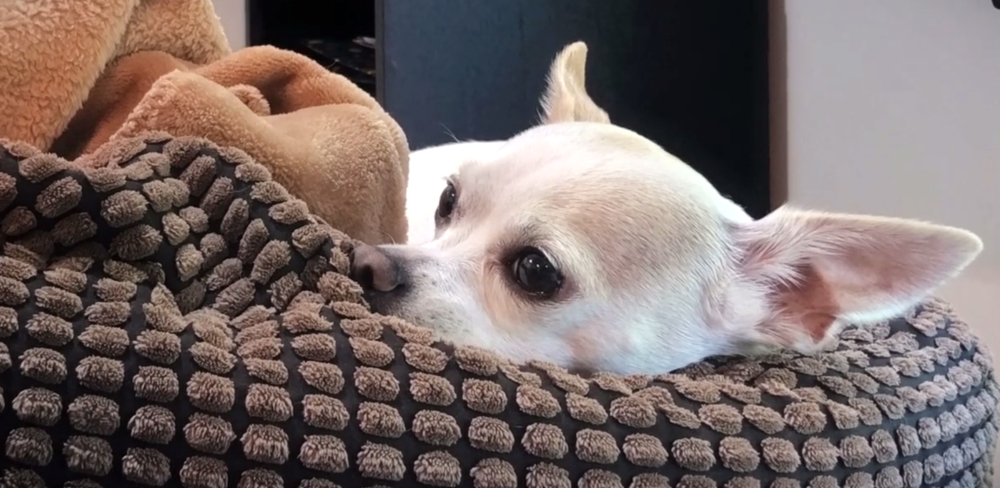

# 🐐 ENGR 350 Section 03 Fall 2026

This is the home repository of the **ENGR 350 Section 03 Fall 2026** class section, which is certified to be the greatest and bestest section of ENGR 350 of all time. We got so many cool people, the chat is active literally 24/7 during our class times, and we literally have the bestest photos of Sadie ever. Like genuinely. It can't be beaten.

# Key Topics
Some key things we learned this year...

- Right to Repair
- Deontology vs Utilitarianism
- Privacy
- VPNs

and so much more!

**In tech ethics we trust.**
